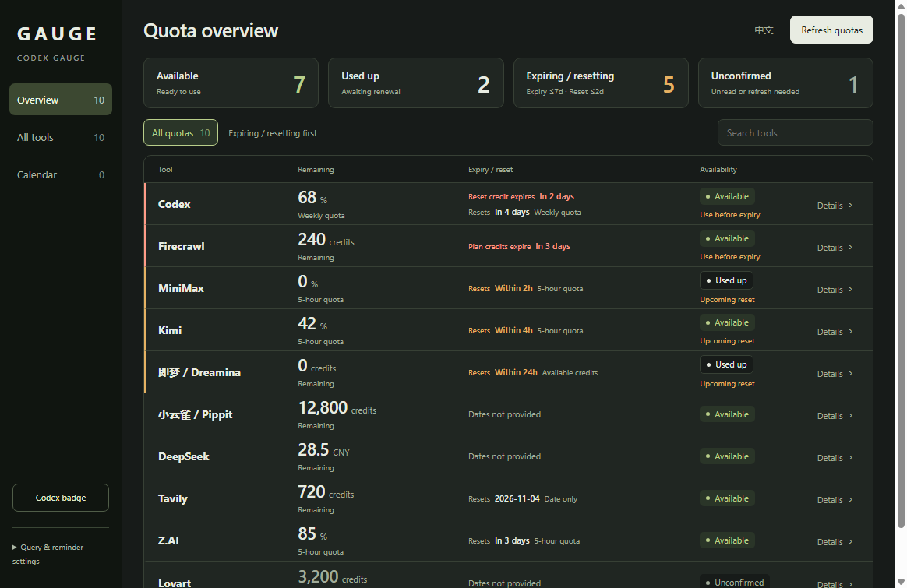
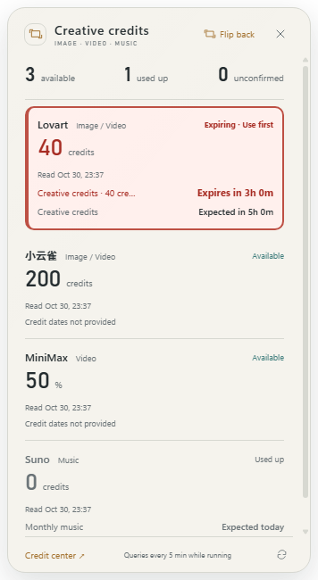

# Codex Gauge

[简体中文](README.zh-CN.md) · [Downloads](https://github.com/Akenaiai/codex-gauge/releases) · [Source](https://github.com/Akenaiai/codex-gauge)

A desktop AI credit center with a small, precision-styled Codex usage gauge above your profile. See which tools have quota, which are used up and which have approaching deadlines. The original hover panel keeps Codex capacity, resets and reset credits close at hand.

**Start here:** [Install and make your first check](docs/GETTING_STARTED.md) · [Local connections and supported queries](docs/GETTING_STARTED.md#3-which-local-connections-are-read) · [Observed vs. estimated dates](docs/GETTING_STARTED.md#4-understand-observed-and-estimated-dates).

**No Gauge account or additional provider login inside Gauge.** It uses the current user's own local CLI/MCP connections or optional API credentials. A new installation includes no developer account, balances or date rules. Discovering a plugin is not proof that its balance can be queried. See the [distribution privacy verification](docs/PRIVACY_VERIFICATION.md).

**Current version: 0.3.7.** The creative flip face puts expiring credits first in red, shows expiry and expected-renewal countdowns together, and moves gray used-up tools to the end. Pool, account and date precision remain explicit. Original Codex face and Suno queries are preserved. [Release notes](docs/releases/0.3.7.md) · [Technical guide](docs/CREDIT_CENTER.md).





**Windows first.** Windows profile anchoring is implemented. macOS source support is an experimental floating-mode preview, not a tested equivalent of the Windows integration.

## What it does

- A 52-pixel gauge follows Codex's profile button on Windows. Hover to expand; click to keep the panel open.
- Shows the 5-hour and weekly windows actually returned by Codex. Weekly-only accounts put their weekly value first. Missing data stays unknown.
- Shows reset times, available reset credits and expiry details. Credit expiry countdowns use days and hours (for example, 84 hours appears as 3d 12h). Optional silent expiry reminders, deduplicated by account and credit.
- Pairs the next scheduled reset countdown with the remaining percentage. With at least 30% remaining, silent reminders fire within 2 hours and 1 hour of the reset, once per account, window and stage. An amber mark on the small gauge points to reminders.
- Active announcements and imminent scheduled resets move above the dials in prominent amber cards. Available reset credits expiring within 48 hours move to the top in red, with a stronger treatment within 24 hours and a red marker on the small gauge. During disconnections, the red credit-expiry marker and priority card retain the last known unexpired deadline, with a last-reading timestamp and an availability-awaiting-refresh label. Elapsed deadlines await refreshed data.
- Shows temporary reset and credit-grant announcements via AIHOT, with original-post links and source collection time. Announced deadlines, estimated windows and confirmations remain distinct; a credit grant never implies an immediate quota reset. No account replenishment is inferred from a public post.
- Drag to adjust position; double-click or use the tray menu to reset. Attached and floating positions are saved separately.
- Graphite, porcelain and system appearance. Complete English and Simplified Chinese interface.
- Tray access, optional start-with-Codex on Windows in installed builds, optional keep-on-top mode, manual update checks with a link to releases.
- Uses local `codex app-server` read-only RPCs. No model prompts, automatic resets, telemetry or account credential export.

## Windows installation

Download the setup executable or portable ZIP from [Releases](https://github.com/Akenaiai/codex-gauge/releases). The app is **not code-signed**. Verify the release source and SHA-256 checksum; do not disable Windows protections.

Choose `Codex.Gauge.Setup.0.3.7.exe` for installation, or fully extract `Codex.Gauge-0.3.7-win.zip` and run `Codex Gauge.exe`. These distributions include the desktop runtime; Node.js is not required. GitHub's **Source code** archive requires the development setup below. The [first-use tutorial](docs/GETTING_STARTED.md) covers checksum comparison, the tray entry, connections and missing-data troubleshooting.

You need Windows 10/11 x64. The original Codex badge additionally needs the Codex desktop app and an installed, signed-in [official Codex CLI](https://github.com/openai/codex). The CLI supplies authentication and current Codex quota data. Keep Codex open for the attached gauge. Other supported providers can use the credit center independently through their own connections; if the profile cannot be located, the tray still opens the panel.

Normal mode hides when Codex is minimized or another app is foreground. Keep-on-top mode remains visible while Codex is minimized; both modes hide the attached gauge when Codex closes. You can still open the panel from the tray.

The original Codex badge needs no extra API key. Other providers reuse existing local connections or optional API credentials. If Codex CLI discovery fails, set `CODEX_GAUGE_CLI` to the **native Codex executable**, not a `.cmd` or `.ps1` wrapper. Restart Gauge after changing the environment.

### Show automatically with Codex

In the installed Windows app, enable **Settings → Start with Codex**. Version 0.1.1 registers a current-user Windows task that runs a small companion launcher independently of Codex. The helper checks for the Codex desktop window every two seconds and opens Gauge when needed. It also recovers an unexpected Gauge exit, with a 30-second retry limit. No administrator password or model calls are required.

The helper starts at Windows sign-in; a one-minute task trigger recovers the helper if it exits. Codex does not have to be running at sign-in. **Quit Codex Gauge** pauses automatic relaunch for the current Codex process; reopening Codex permits it again. Disable **Start with Codex** to remove the task. The installer stops the helper before replacement, and uninstall removes its task.

An enabled 0.1.0 login-startup preference migrates when 0.1.1 first runs. When Gauge was previously launched inside the MSIX Codex environment, the helper resolves the physical settings file and imports it only if the normal Windows profile has no settings file. Existing normal-profile settings are never overwritten. This fixes the observed case where interactive and scheduled launches saw different settings locations. The default remains off for new users.

If the gauge remains absent, open it from the desktop or Start menu and check its settings. Local `follow-status.json` in Gauge's user-data folder records only launcher state, host count and error types; it contains no account or quota information. A real Windows re-login and a future Codex update still need field verification.

## Run from Git

Install Node.js 22.12+ (a current LTS version is recommended) and Git. To use the original Codex badge, also install and sign in to the official Codex CLI and open the Codex desktop app.

```sh
git clone https://github.com/Akenaiai/codex-gauge.git
cd codex-gauge
npm ci
npm start
```

Windows automatically compiles the small UI Automation observer using the system .NET Framework compiler. It only reads window geometry and the named profile control, and exits when Gauge exits.

### macOS preview

The same Git commands run the experimental floating gauge on Mac. This version does **not** yet attach above the Mac Codex profile or follow its window lifecycle. It does not request Accessibility permissions. It has not been verified on a Mac; source compatibility is not a claim of completed Mac support. CLI discovery searches PATH, common Homebrew paths and standard npm locations; use `CODEX_GAUGE_CLI` for custom installations.

On a Mac, `npm run build:mac` builds a local DMG/ZIP. No Apple signing or notarization is configured. Do not treat a Windows executable as a Mac installer. See [the Mac handoff](docs/MAC.md) for remaining work.

## Develop and verify

```sh
npm test              # data, account-switch, persistence and placement checks
npm run smoke        # real read-only quota connection; outputs capabilities only
npm run preview      # http://127.0.0.1:4387, synthetic demo data only
npm run build:win    # Windows setup executable + portable ZIP
```

`npm start -- --demo` opens an isolated native preview with sample data; it never starts Codex or sends notifications. Icons are checked in; regenerating them with `python scripts/generate-icons.py` optionally needs Pillow.

For notification changes, use the [isolated Windows acceptance instructions](docs/NOTIFICATIONS.md). They distinguish automated failure/retry checks, installed synthetic tests and the unchanged production installation. The test installer uses a separate identity and configuration.

## Data and limitations

Settings, balance snapshots, user-supplied account aliases/dates and reminder receipts stay in the application's per-user data folder. Account identities are hashed in reminder keys. Gauge introduces no provider browser-login flow and does not read browser cookies, copy client auth files, or save chat content/raw app-server output. Optional API connections are verified and encrypted locally. Settings are written after changes; corrupt existing files are preserved and reported instead of silently overwritten.

Usage reset reminders and public announcements are enabled by default and have separate settings switches. Credit-expiry notifications keep their existing separate setting. Notifications open the usage panel when clicked. New public confirmations form a historical baseline on the first fetch, rather than replaying old news; new announcements and subsequent material changes can notify. Reminder fingerprints persist across restarts. Naturally occurring reset notifications and Windows notification-center delivery still require field verification.

While Codex is open or the usage panel is opened manually, the app checks the anonymous [AIHOT recent-reset feed](https://aihot.news/api/v1/codex-resets/recent) every five minutes. Requests send no account, balance, chat, authentication data or model prompts. The service receives ordinary network metadata such as the IP address and application User-Agent. Conditional requests, cache lifetime and Retry-After are respected. The last response stays in memory; only hashed event fingerprints are saved. Failed, empty or malformed responses retain the previous display with a stale warning. Old source verification times suppress actionable news reminders. Closing the app, closing Codex without an open panel, sleeping the computer or disabling announcements stops these checks; this is not an overnight monitoring service.

Public announcements are third-party summaries, not a guaranteed early-warning channel. A post may specify only a time range or appear after the reset. Exact countdowns require an exact announced time; deadlines are shown as “by” and may occur earlier. Use the original post and actual account data before deciding whether to spend a reset credit. The app neither spends credits nor changes the model's reasoning settings or creates work to consume usage.

AIHOT is a third-party source. Its [public use rules](https://aihot.news/terms), checked on 2026-10-21, allow eligible personal, nonprofit and internal use. Commercial uses and data redistribution may require separate permission; this repository's MIT license covers its code, not AIHOT data, service or third-party posts. No live announcement data is distributed in the repository or installers.

Usage is polled once per minute while active, with bounded retry backoff. Failed reads are marked stale; passing a scheduled reset time never invents replenished quota. Reset cards are view-only.

Manual update checks contact the public GitHub release API. There is no background update checking or automatic installation in 0.1.0. The Electron runtime makes the distribution larger than the reference Tauri app. Profile anchoring depends on Codex's accessible control names and may need adjustment after a desktop update. Long-running sleep/resume, every display scale and multi-monitor configurations still need broader field testing.

## Credits and license

Functional inspiration and selected implementation rules: [returnk/codex-usage-badge](https://github.com/returnk/codex-usage-badge). See [third-party notices](THIRD_PARTY_NOTICES.md) for the exact reference and its MIT license. This project has a new instrument-style interface and an independent desktop implementation.

MIT © 2026 Aken. Built with AI assistance. Independent software; not affiliated with or endorsed by OpenAI. Support: [GitHub issues](https://github.com/Akenaiai/codex-gauge/issues) or 934026@qq.com.
