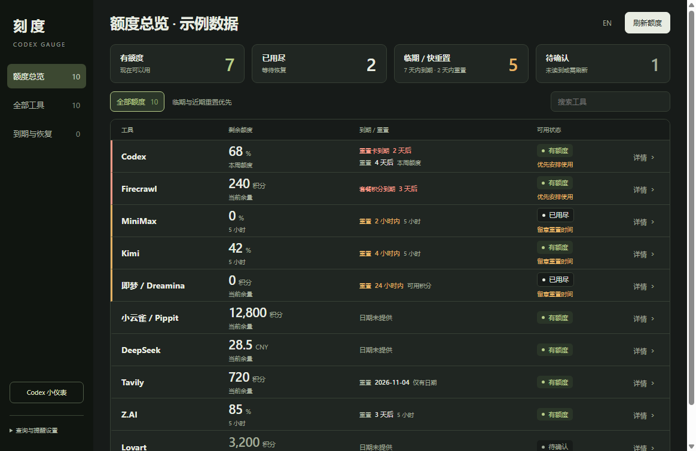
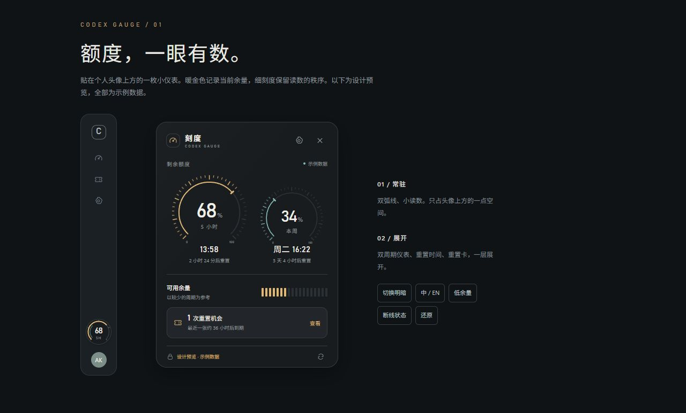

# 刻度 · Codex Gauge

[English](README.md) · [下载](https://github.com/Akenaiai/codex-gauge/releases) · [源码](https://github.com/Akenaiai/codex-gauge)

统一查看本机 AI 工具额度的桌面看板，一眼区分有额度、已用尽和临期工具。原来贴在 Codex 头像上方的小仪表继续保留，悬停可看剩余额度、重置时间和可用重置卡。

**第一次用，从这里开始：** [安装与首次查询](docs/GETTING_STARTED.zh-CN.md) · [会读取哪些本机连接](docs/GETTING_STARTED.zh-CN.md#3-会读取哪些本机连接) · [哪些日期是实查哪些是预计](docs/GETTING_STARTED.zh-CN.md#4-哪些日期是实查哪些是预计)。

**不用注册刻度账号，不用在刻度里额外登录平台。** 查询沿用当前用户自己电脑上的 CLI / MCP 连接或可选 API 凭据。新安装不带开发者账号、余额和日期规则；发现插件不代表能查余额。详见[分发隐私核对记录](docs/PRIVACY_VERIFICATION.md)。

**当前版本 0.3.4：** 首页区分“有额度、已用尽、临期 / 快重置、待确认”。自动余额、上次网页核对、每月预计发放分别标注来源；余额刷新不更新网页记录，预计不代表已到账。[版本说明](docs/releases/0.3.4.md) · [额度中心进阶说明](docs/CREDIT_CENTER.md)。





**先完成 Windows。** Windows 头像定位已实现；Mac 合并候选已包含原生头像吸附、更新按钮避让及随 Codex 启停；本机自动检查与打包通过，真实窗口体验仍待验收，详见 docs/MAC.md。

断连时，头像红色到期标记和置顶临期卡保留上次记录的未到期时间，并标明“上次数据”、记录时间及“实际可用情况待刷新确认”；连接恢复后按新数据更新。

## 功能

- 52 像素小仪表跟随 Windows Codex 头像。悬停展开，点击固定面板。
- 按实际接口显示 5 小时、本周额度。只有周额度时自动放到主位；没有返回的信息保持未知。
- 显示重置时间、重置机会及到期详情。重置卡按“几天几小时”显示剩余时间，例如 84 小时显示为“3 天 12 小时”。可选静默到期通知，按账户、卡片和阶段去重。
- 将下次周期重置倒计时和剩余百分比放在一起。余量 ≥30% 时，在重置前 2 小时、1 小时内分别静默提醒一次，按账户、周期和阶段去重；小仪表显示暖金色提醒标记。
- 有效预告和临近的周期重置会提到仪表上方，用醒目的橙金色卡片展示。可用重置卡剩余 48 小时内置顶为红色临期卡，24 小时内进一步加强提示，小仪表也显示红色标记；过期时间和旧读数仍保留明确的更新状态。
- 展示 AIHOT 整理的临时重置与发卡消息、原帖入口和来源核对时间。预告截止时间、估计时段和确认状态分别展示；发卡消息不等于立即重置，公开确认也不等于本人账户已恢复。
- 拖动调整、双击归位；跟随位置和置顶位置分别保存。
- 石墨黑、瓷白、跟随系统；完整简体中文和英文界面。
- 托盘入口、Windows 安装版可选随 Codex 启动、置顶、手动检查更新及版本下载入口。
- 通过本机 `codex app-server` 只读查询；不发送模型请求，不自动使用重置卡，不上传凭据。

## Windows 安装

从[发布页](https://github.com/Akenaiai/codex-gauge/releases)下载安装程序或绿色 ZIP。当前程序**没有 Windows 代码签名**，请核对来源和 SHA-256，不关闭系统保护。

安装版选 `Codex.Gauge.Setup.0.3.4.exe`；免安装版选 `Codex.Gauge-0.3.4-win.zip`，完整解压后运行 `Codex Gauge.exe`。两者已包含桌面运行环境，不需要另装 Node.js。GitHub 的 **Source code** 压缩包是源码，需要下方的开发环境。[首次使用教程](docs/GETTING_STARTED.zh-CN.md)包含校验方法、托盘入口、连接说明和缺失数据排查。

需要 Windows 10/11 x64。原 Codex 小仪表还需要 Codex 桌面客户端，以及已经安装并登录的[官方 Codex CLI](https://github.com/openai/codex)，由 CLI 提供本机登录和 Codex 额度数据。打开 Codex 后，仪表会定位到个人头像上方；其他已支持平台可通过自己的连接独立使用额度中心，暂时无法定位头像时仍可从托盘打开。

普通模式在 Codex 最小化或其他应用位于前台时隐藏；置顶模式在 Codex 最小化后仍可见。Codex 关闭后两种模式都收起小仪表，托盘仍能打开详情。

原 Codex 小仪表无需额外 API Key；其他平台沿用本机已有连接或可选 API 凭据，不新增平台网页登录。自定义 CLI 安装位置可用 `CODEX_GAUGE_CLI` 指向**原生可执行文件**，不要指向 `.cmd`、`.ps1` 启动脚本。修改后重启刻度。

### 随 Codex 自动启动

在 Windows 安装版中开启 **设置 → 随 Codex 启动**。0.1.1 会登记当前用户的 Windows 后台任务，由独立的小型启动助手每两秒检测 Codex 桌面窗口，按需打开刻度。刻度意外退出时也会恢复，两次启动尝试至少间隔 30 秒。不需要管理员密码，不调用模型。

助手在登录 Windows 时启动；每分钟的恢复触发器会在助手退出后重新拉起它。登录时不必已经打开 Codex。选择托盘中的 **退出刻度**，会暂停当前 Codex 进程期间的自动拉起，重新打开 Codex 后恢复。关闭 **随 Codex 启动** 可移除后台任务。安装升级会先停止助手，卸载会移除任务。

0.1.0 已开启的开机启动选项会在首次运行 0.1.1 时迁移。如果旧版从 MSIX 版 Codex 的隔离环境启动过，助手会解析设置文件的实际位置，仅在普通 Windows 用户目录没有设置时导入，已有设置不会被覆盖。这处理了本次发现的交互启动与系统启动读取不同设置目录的问题。新用户仍默认关闭。

若仪表仍未出现，可从桌面或开始菜单打开刻度并检查设置。用户数据目录的 `follow-status.json` 仅记录启动状态、窗口数量和错误类型，不含账户和额度。自然重新登录 Windows 及后续 Codex 更新仍需现场验证。

## 通过 Git 运行

先安装 Node.js 22.12+（推荐当前 LTS）和 Git。需要使用原 Codex 小仪表时，再安装并登录官方 Codex CLI、打开 Codex 桌面客户端。

```sh
git clone https://github.com/Akenaiai/codex-gauge.git
cd codex-gauge
npm ci
npm start
```

Windows 安装依赖时会用系统 .NET Framework 编译小型窗口观察器。它只读窗口几何和已命名的头像控件，随刻度退出。

### Mac 适配与接续

合并候选的 Mac 安装包已包含独立启停助手，可在设置开启“随 Codex 启动”。它使用当前用户 LaunchAgent：打开 Codex 时启动刻度，退出 Codex 时关闭刻度；手动退出刻度后暂停到下次 Codex 会话。开关默认关闭，关闭时保留可恢复配置，注册失败回退原有助手。它不需要模型请求，也不代替头像跟随所需的系统权限。

Mac 源码已增加原生头像吸附模块：在刻度面板点击“开启头像跟随”，由用户手动授予系统辅助功能权限后，按真实控件位置跟随窗口。控件丢失时收起仪表，不回退桌面悬浮。自动几何、可见性检查与本机打包已通过；真实 Codex 窗口跟随、跨屏和休眠仍待现场验收。CLI 查找覆盖 PATH、常见 Homebrew 和 npm 目录；特殊安装可配置 `CODEX_GAUGE_CLI`。

在 Mac 上执行 `npm run build:mac` 可以进行本地 DMG/ZIP 构建。当前没有配置 Apple 签名、公证；Windows 安装程序不能用于 Mac。后续适配入口见 [Mac 接续说明](docs/MAC.md)。

## 开发与验证

```sh
npm test              # 数据解析、账户切换、保存恢复与定位边界
npm run smoke        # 真实只读连接，只输出能力状态，不输出账户或额度值
npm run preview      # http://127.0.0.1:4387，仅示例数据
npm run build:win    # Windows 安装程序和绿色 ZIP
```

`npm start -- --demo` 使用独立临时设置显示原生示例，不启动 Codex，也不发送提醒。图标已包含在源码中；可选的图标重建脚本 `python scripts/generate-icons.py` 需要 Pillow。

通知改动请按[隔离 Windows 验收指令](docs/NOTIFICATIONS.md)执行，分别记录自动失败重试检查、独立安装身份的合成事件测试，以及正式安装环境的真实点击。测试安装包使用独立配置。

## 数据和当前边界

设置与提醒去重记录只保存在应用的当前用户数据目录。提醒键中的账户标识经过哈希，不保存额度历史、邮箱、认证文件、聊天内容或原始服务输出。设置修改后立即保存；原文件损坏时保护原件并提示，避免覆盖。

额度重置提醒和临时消息默认开启，可在设置里分别关闭；原有重置卡到期通知仍沿用独立开关。点击系统通知可打开额度面板。第一次读取只将已有确认消息记为基线，不重放旧新闻；新预告和后续实质变化可以提醒，去重记录跨重启保留。自然发生的重置通知及 Windows 通知中心实际送达仍待现场验证。

Codex 打开或手动打开额度面板时，程序每 5 分钟匿名核对 [AIHOT 近期重置接口](https://aihot.news/api/v1/codex-resets/recent)。请求不发送账户、余额、聊天、登录信息或模型提示词；服务会收到 IP 地址及应用 User-Agent 等普通网络信息。遵守条件请求、缓存时间和 Retry-After。最近响应只保留在内存，仅保存哈希后的消息指纹；请求失败、空列表或格式异常时保留上次展示并标记过期，来源核对时间过旧时不发送可行动的消息提醒。退出程序、关闭 Codex 且没有打开面板、电脑休眠或关闭消息开关时停止检查，不承担跨夜监控。

公开预告来自第三方整理，无法保证每次都有提前提醒。有些原帖只给时间范围，有些在重置后才确认；精确时间才能显示精确倒计时，截止时间会写明“最晚……前，可能提前”。判断用卡时机时需同时核对原帖和账户实际额度。程序不自动用卡、不调整模型思考设置，也不创建任务来消耗额度。

AIHOT 是第三方消息源。2026-10-21 核对的[公开使用规则](https://aihot.news/terms)允许符合条件的个人非商业、公益非商业和组织内部使用；商用或数据再分发等场景可能需要单独许可。本仓库 MIT 仅覆盖代码，不覆盖 AIHOT 数据、服务与第三方原帖；仓库和安装包不包含真实消息数据。

活跃时每分钟刷新，失败后逐步延长重试间隔。读取失败保留上次读数并明确标记；预计重置时间到了，不代表已确认额度恢复。重置卡只看不使用。

手动检查更新时访问 GitHub 公开发布接口。0.1.0 没有后台自动检查或一键安装更新。Electron 的分发体积比参考项目的 Tauri 方案更大。头像定位依赖 Codex 控件名称，桌面版本变化后可能需要调整；长时间休眠恢复、全部显示缩放和多显示器组合仍需扩大实测。

## 来源与许可

功能参考及部分实现规则来自 [returnk/codex-usage-badge](https://github.com/returnk/codex-usage-badge)。准确版本、借鉴范围和原 MIT 许可见[第三方声明](THIRD_PARTY_NOTICES.md)。本项目重做仪表界面并独立实现桌面架构。

MIT © 2026 阿肯，使用 AI 辅助制作。第三方工具，与 OpenAI 无隶属关系。反馈：[GitHub Issues](https://github.com/Akenaiai/codex-gauge/issues)，或 934026@qq.com。
