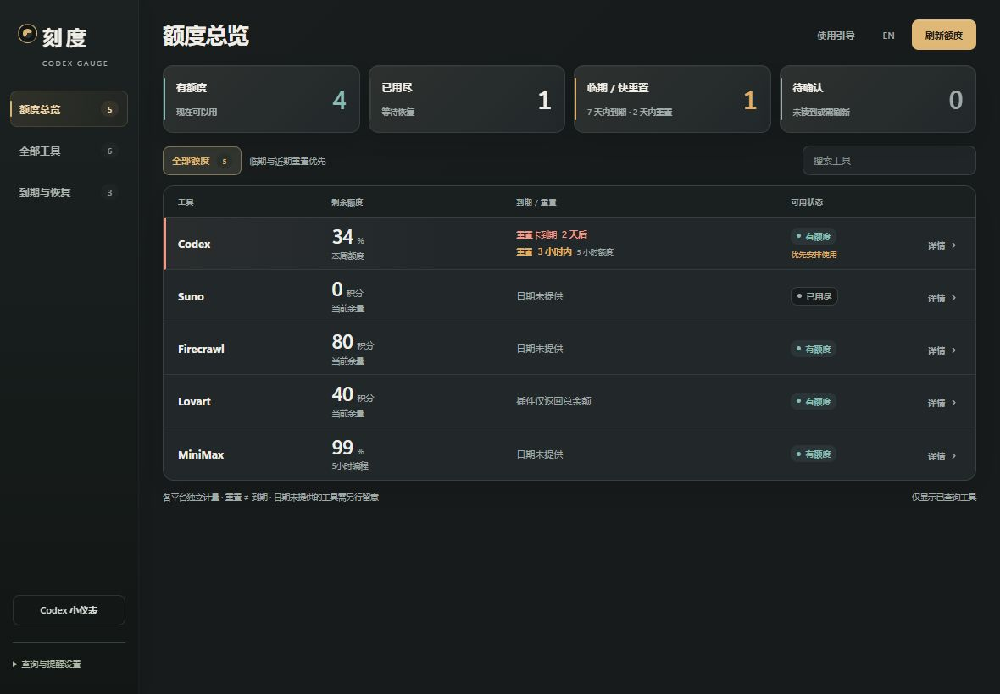
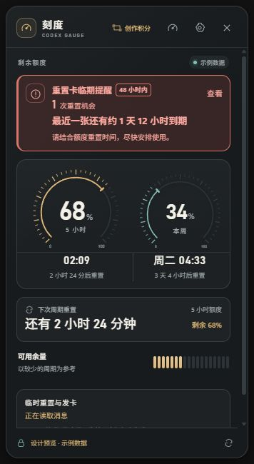
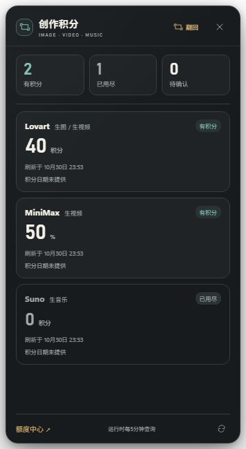

# Visual refresh validation — 2026-10-30

This CSS-only update refines the 52px Codex badge, its expanded Codex and creative-credit faces, and the full AI credit center. It improves type hierarchy, number scanning, contrast, surfaces, navigation, status pills, dialogs and compact layouts. Existing IPC, data interpretation, accounts, reminders, storage and window positioning are unchanged.

Visual implementation was assisted by **Kimi K3.1 Pro**, with independent source review and runtime verification. The implementation was developed against v0.3.7 in an isolated branch; this record does not mean a new installer has been released or installed.

## Verification

- 145 automated checks passed.
- 21 isolated native Electron flow checks passed, including the 52px footprint, front/back switching, persisted face choice, media-only creative quotas, stale/empty states, English/light narrow layouts and reduced motion.
- The real renderer files were exercised in Browser using synthetic, isolated bridge data: 1180×820 center, 700×560 minimum center, and 356×650 panel layouts.
- Used-up filtering, tool search/clear, details, first-use guidance and date-entry dialogs were exercised. The minimum-width page and dialogs had no horizontal overflow; relevant renderer error logs were empty.
- All screenshots below contain synthetic example data, not a developer account or live balance. Windows desktop behavior and aesthetic acceptance are distinct; Mac and real-device coverage have not been expanded.

## 中文说明

本次只更新五份界面样式，覆盖52像素小仪表、展开正反面、大看板、引导和日期表单。数据、账户、提醒、存储及定位机制没有改动。145项自动检查、21项隔离原生流程和实际渲染页面的主要交互检查通过。截图均为合成样例；本记录不表示新版安装包已发布、已安装，也不代替本人视觉认可。
